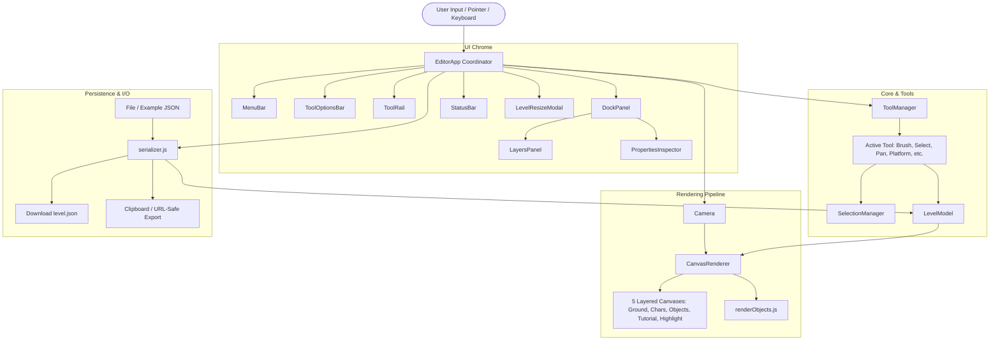
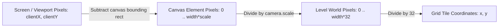

# FBWG-Editor Technical Architecture

This document provides a comprehensive technical overview of the **FBWG-Editor** architecture, subsystem boundaries, data flow, and rendering pipeline.

---

## 1. System Overview

FBWG-Editor is structured as an event-driven, decoupled client-side web application. It requires no backend server and runs entirely in modern web browsers using standard ES modules and the HTML5 Canvas API.



---

## 2. Core Subsystems

### 2.1 Application Coordinator (`EditorApp.js`)
The `EditorApp` class serves as the central hub connecting UI chrome, tools, viewport navigation, and level models:
- **Mounting:** Replaces the `#application` container with the full Photoshop layout.
- **Shortcuts:** Routes global keyboard events (<kbd>V</kbd>, <kbd>H</kbd>, <kbd>B</kbd>, <kbd>Ctrl+S</kbd>, <kbd>Delete</kbd>, etc.).
- **Viewport Management:** Coordinates viewport resizing, camera scale updates, and DOM transform positioning.
- **File I/O:** Orchestrates reading JSON files, saving levels, exporting to clipboard, and reloading example level templates.

### 2.2 Data Model (`src/js/level/`)

#### `LevelModel.js`
The single source of truth for the active document:
- Holds grid width and height in tiles.
- Owns the `TileMap` instance storing the Ground layer grid.
- Maintains an array of `LevelObject` instances.
- Manages unique object ID incrementation (`nextObjectId`).
- Handles level resizing and automatically prunes tiles and objects that exceed new boundaries.

#### `TileMap.js`
A flattened 1D array representing the 2D grid:
- Indexing equation: `index = y * width + x`.
- Optimized for quick lookups and bulk resize reallocation.

#### `LevelObject.js`
Represents an individual interactive object:
- Stores spatial attributes (`x`, `y`, `width`, `height`, `rotation`, `visible`).
- Stores logical attributes (`id`, `name`, `type`, `gid`, `layer`, `properties`).
- Supports cloning, coordinate containment tests (`containsPoint`), and bounding box computation.

---

## 3. Viewport & Rendering Pipeline

### 3.1 Multi-Layer Canvas Stack
Instead of rendering everything onto a single monolithic canvas, FBWG-Editor uses five transparent, absolutely positioned HTML5 `<canvas>` elements stacked inside `.canvas-content`:

```
┌──────────────────────────────────────────────┐
│  5. Highlight Canvas (Selection outlines)    │
├──────────────────────────────────────────────┤
│  4. Tutorial_keyboard Canvas (Text hints)    │
├──────────────────────────────────────────────┤
│  3. Objects Canvas (Buttons, Levers, Boxes)  │
├──────────────────────────────────────────────┤
│  2. Chars Canvas (Spawns, Doors, Diamonds)   │
├──────────────────────────────────────────────┤
│  1. Ground Canvas (Tiles, Slopes, Fluids)    │
└──────────────────────────────────────────────┘
```

**Benefits:**
- **Layer Isolation:** Hidden layers simply clear their respective canvas; locked layers remain visible but reject selection events.
- **Performance:** Moving an object only requires re-rendering the affected object layer and the highlight overlay.
- **Visual Accuracy:** Mirrors the canonical Tiled rendering order.

### 3.2 Pinned Content & Whole-Canvas Panning
To avoid content drifting relative to the canvas boundary or background grid lines:
1. **Pinned Rendering:** Inside `CanvasRenderer.js`, 2D contexts always translate to `(0, 0)` (`pinContent: true`), applying only `this.camera.scale`. Content is always pinned to the top-left of the canvas element.
2. **GPU-Accelerated Pan:** When panning with the Hand tool, <kbd>Space</kbd>+drag, or Middle-click drag, `Camera.pan(dx, dy)` updates the camera coordinates, and `.canvas-container` is translated in the DOM via CSS:
   ```css
   transform: translate(${camera.x}px, ${camera.y}px);
   ```
   This moves the entire document (background grid, borders, and all canvas layers) as one unified document without shifting drawing coordinates.

---

## 4. Coordinate Transformation Systems

The application converts seamlessly across three distinct coordinate spaces:



- **Screen / Viewport Space:** Raw mouse events from the browser.
- **Canvas Element Space:** Pixels relative to the top-left of `.canvas-content` (`e.clientX - rect.left`).
- **World Space:** The level's logical coordinate space where tiles are `32×32` pixels (`canvasX / camera.scale`).
- **Grid Tile Space:** Integer tile coordinates in the grid (`Math.floor(worldX / 32)`).

---

## 5. Tool Subsystem (`src/js/tools/`)

All editing tools extend `ToolBase.js` and register with `ToolManager.js`.

### Tool Lifecycle
1. **Activation:** When a tool is selected, `ToolManager.setActiveTool(name)` calls `deactivate()` on the old tool and `activate()` on the new tool.
2. **Cursor Configuration:** Tools specify their preferred mouse cursor (e.g., `crosshair`, `grab`, `default`).
3. **Event Routing:** Pointer down, move, and up events are converted into normalized event objects containing:
   - `worldX`, `worldY`: Scaled level coordinates.
   - `screenX`, `screenY`: Canvas-relative pixel coordinates.
   - `rawEvent`: Native browser event.

---

## 6. Dock & Inspector Subsystem (`src/js/interface/dock/`)

### `LayersPanel.js`
- Displays the 4 canonical layers.
- Provides eye icon (visibility) and padlock icon (locking).
- Enforces selection safety: if a layer is hidden or locked, objects residing on that layer cannot be selected. Toggling an active object's layer to hidden/locked automatically deselects it.

### `PropertiesInspector.js`
- Displays editable properties for the single selected object:
  - Object identification: ID, Type, Layer.
  - Spatial properties: X, Y, Width, Height.
  - Interactive platform / switch settings: Color Group (1–8), Horizontal delta (`dx`), Vertical delta (`dy`).
  - Text trigger content: Pixel size, font family, display text.
- Changes are applied immediately to `LevelModel` and trigger an immediate redraw of the relevant canvas layers.
